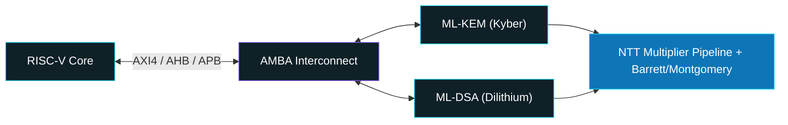

 

**QKD, PQC & LDPC | ASIC/VLSI | FPGA RTL Design & Verification | RISC-V SoC | SystemVerilog | AMBA | CDC | Synthesis | Genus & Innovus**

 

  

## 👨‍💻 About Me

Electronics and Communication Engineering student specializing at the boundary of **VLSI Design, RTL Architecture, and Post-Quantum / QKD Hardware Security**. I focus on high-throughput digital logic, ultra-low-latency control platforms, and hardware-accelerated cryptographic primitives for next-generation quantum networks.

📍 Tirupati, India

## 🔐 Quantum Key Distribution (QKD) Hardware

- **Post-Processing Acceleration:** RTL architecture for sifting, QBER estimation, high-throughput LDPC error correction, and Toeplitz matrix-based privacy amplification
- **Protocols:** BB84, E91, and decoy-state multi-intensity protocols
- **Network Subsystems:** multi-channel time-tagging logic for single-photon counting modules (SPCMs), low-jitter clock alignment, and CDC synchronization across optical links

  
   
  Conceptual QKD system setup (AI-generated illustration): Alice Tx, Bob Rx, FPGA key generation and SNSPD detection

## 🛡️ Post-Quantum Cryptography (PQC) & Hardware Security

- **Lattice-Based Accelerators:** ML-KEM (Kyber) and ML-DSA (Dilithium) with NTT multiplier pipelines and Barrett/Montgomery reduction
- **Secure SoC Design:** RISC-V core integration with memory-mapped crypto-coprocessors over AMBA AXI4/AHB/APB, with side-channel countermeasures

## ⚙️ ASIC & FPGA Implementation Flow

- **Front-End:** SystemVerilog/Verilog microarchitectures, parameterizable FSMs, and testbenches in ModelSim and Vivado Simulator
- **Physical Design:** RTL-to-GDSII using Cadence Genus (synthesis) and Cadence Innovus (floorplanning, place-and-route, STA, timing closure)

### 🧱 Physical Design: Cadence Innovus

<table align="center">
  <tr>
    <td align="center" width="50%">
      
       
      Floorplan with memory macro placement
    </td>
    <td align="center" width="50%">
      
       
      Floorplan with net connectivity (flight lines) view
    </td>
  </tr>
</table>

### 🧪 RTL Simulation: RAM/ROM Memory System (Vivado)

<table align="center">
  <tr>
    <td align="center" width="50%">
      
       
      Simulation waveform: clk, we, sel, addr, din, dout
    </td>
    <td align="center" width="50%">
      
       
      Timing waveform: write, then read-back across memory select
    </td>
  </tr>
</table>

## 🛠️ Technical Stack

**HDL & Verification**

**EDA Tools**

**Quantum Simulation**

**Circuit & PCB**

**Protocols**

## 🚀 Featured Projects

| Project | Description | Tech |
|---|---|---|
| RAM/ROM Memory System | Memory system with write/read and select logic, verified with a testbench in Vivado | Verilog |
| Physical Design (Innovus) | Floorplan and placement with memory macros | Cadence Innovus |

## 📊 GitHub Stats

 

 

